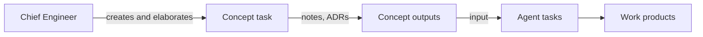

# Process strategy

Main description of the engineering process used in this project. Detailed rules live in the
documents linked below.

## Overview

The project uses an agent-based workflow:

- The **Chief Engineer** defines *what* should be achieved, at a high level, in concept tasks.
- Once a concept is elaborated, **agents** coordinated by the orchestrator turn it into
  process work products (requirements, architecture, implementation, tests).

## Roles

| Role | Responsibility |
|------|----------------|
| Chief Engineer | Owns concept tasks, makes architectural decisions, approves key status transitions |
| Orchestrator | Main Claude Code session; delegates work to agents and reports status to the Chief Engineer |
| Agents | Specialised roles; provisional: System Engineer, SW Architect, SW Developer, Test Engineer, Reviewer |

## Task types

Each task type is described in `Process/TaskTypes/` and has a template in `Process/Templates/Tasks/`.

| Type | ID | Owner | Description | Template |
|------|----|-------|-------------|----------|
| [[Process/TaskTypes/Concept\|Concept]] | `CON-NNNN` | Chief Engineer | Epic-like entry point for a topic; its outputs are the input for agent tasks | [[Process/Templates/Tasks/Concept\|Concept template]] |
| [[Process/TaskTypes/System Requirements\|System Requirements]] | `SYSREQ-NNNN` | System Engineer | System-level requirements describing system behaviour | [[Process/Templates/Tasks/System Requirements\|System Requirements template]] |
| [[Process/TaskTypes/System Architecture\|System Architecture]] | `SYSARCH-NNNN` | System Engineer | High-level components, deployment, available hardware | [[Process/Templates/Tasks/System Architecture\|System Architecture template]] |
| [[Process/TaskTypes/Software Requirements\|Software Requirements]] | `SWREQ-NNNN` | SW Architect | Software requirements derived from the system level | [[Process/Templates/Tasks/Software Requirements\|Software Requirements template]] |
| [[Process/TaskTypes/Software Architecture\|Software Architecture]] | `SWARCH-NNNN` | SW Architect | Software components and interfaces | [[Process/Templates/Tasks/Software Architecture\|Software Architecture template]] |
| [[Process/TaskTypes/Software Implementation\|Software Implementation]] | `SWIMPL-NNNN` | SW Developer | Implementation and integration of the firmware | [[Process/Templates/Tasks/Software Implementation\|Software Implementation template]] |
| [[Process/TaskTypes/Unit Test\|Unit Test]] | `UNITTEST-NNNN` | Test Engineer | Unit test specification and execution | [[Process/Templates/Tasks/Unit Test\|Unit Test template]] |
| [[Process/TaskTypes/Integration Test\|Integration Test]] | `INTTEST-NNNN` | Test Engineer | Integration test specification and execution | [[Process/Templates/Tasks/Integration Test\|Integration Test template]] |
| [[Process/TaskTypes/Environment Setup\|Environment Setup]] | `ENVSETUP-NNNN` | SW Developer | Development environment, toolchain, CI | [[Process/Templates/Tasks/Environment Setup\|Environment Setup template]] |
| [[Process/TaskTypes/Process Improvement\|Process Improvement]] | `PROCIMPROV-NNNN` | Chief Engineer | Improvements of the project's process | [[Process/Templates/Tasks/Process Improvement\|Process Improvement template]] |

All agent task types share one lifecycle, described in
[[Process/TaskTypes/AgentTask|Agent task lifecycle]].

Common rules for all task types:

- One file per task, named `PREFIX-NNNN Topic.md`; the task ID is `PREFIX-NNNN` (never reused).
- The status is kept in YAML frontmatter and is the single source of truth.
- Status values are written in UPPERCASE, words separated with `_`.
- Common base fields of every task: `type`, `id`, `title`, `status`, `assignee`, `parent`,
  `created`, `updated`, `closed` (dates as `YYYY-MM-DD`; `closed` empty until a final status).
- Every status change updates the `updated` field and adds an entry to the task's Log.
- Derived tasks link to their origin with the `parent` field; links point from the derived
  element to its source.
- The state diagram of a task type is part of its type description; templates and task
  instances do not contain it.

## Documentation structure

| Folder | Content |
|--------|---------|
| `Process/` | This strategy and detailed process rules |
| `Process/TaskTypes/` | One document per task type |
| `Process/Templates/Tasks/` | Task templates |
| `Tasks/Concepts/` | Concept tasks |
| `Tasks/System/` | System requirements and architecture tasks |
| `Tasks/Software/` | Software requirements, architecture and implementation tasks |
| `Tasks/Test/` | Unit and integration test tasks |
| `Tasks/Support/` | Environment setup and process improvement tasks |
| `Architecture/Concept Level/ADR/` | Architecture Decision Records produced by concept tasks |
| `Architecture/Concept Level/Notes/` | Notes produced by concept tasks |
| `Architecture/System Level/` | System architecture |
| `Architecture/Software Level/` | Software architecture |
| `Tasks/Dashboards/` | Task status dashboards (Obsidian Bases) |

## Dashboards

The current status of tasks is presented in Obsidian Bases (`.base` files in `Tasks/Dashboards/`).
Dashboards only read the YAML fields of the tasks and store no data, so the task files remain
the single source of truth.

| Dashboard | Audience | Content |
|-----------|----------|---------|
| Waiting for approval | Chief Engineer | Agent tasks in `IN_REVIEW` |
| Concepts to close | Chief Engineer | Concepts in `IN_IMPLEMENTATION` |
| My open tasks | Chief Engineer | Tasks with `assignee: CHIEF_ENGINEER` not in a final status |
| Process Improvement | Chief Engineer, orchestrator | Process improvement tasks: active and all |
| Environment Setup | Chief Engineer, orchestrator | Environment setup tasks: active and all |
| Concepts | Chief Engineer, orchestrator | All agent tasks grouped by concept |
| Derived tasks | Chief Engineer | Base embedded in every concept task: its tasks grouped by task type |

Concept overview: Bases cannot follow the `parent` chain over several levels, so every agent
task carries the `concept` field (link to the source concept, copied from the parent task on
creation). The concept overviews filter on this field; the concept itself stores no links to its
tasks.

Rules:

- A status is never changed in a dashboard view; it is changed in the task file.
- A new dashboard is added to the table above together with its purpose.
- When a task field used by a dashboard changes, the affected dashboards are updated in the same
  change.

## Open topics

- Rules for work products and their traceability
- ADR and note templates
- Agent profiles
