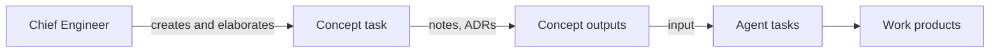

# Process strategy

Main description of the engineering process used in this project. Detailed rules live in the
documents linked below.

## Overview

The project uses an agent-based workflow:

- The **Chief Engineer** defines *what* should be achieved, at a high level, in concept tasks.
- Once a concept is elaborated, **agents** coordinated by the orchestrator turn it into
  process work products (requirements, architecture, implementation, tests).

## Roles

| Role | Responsibility |
|------|----------------|
| Chief Engineer | Owns concept tasks, makes architectural decisions, approves key status transitions |
| Orchestrator | Main Claude Code session; delegates work to agents and reports status to the Chief Engineer |
| Agents | Specialised roles (TBD) |

## Task types

Each task type is described in `Process/TaskTypes/` and has a template in `Process/Templates/Tasks/`.

| Type | ID | Owner | Description | Template |
|------|----|-------|-------------|----------|
| [[Process/TaskTypes/Concept\|Concept]] | `CON-NNN` | Chief Engineer | Epic-like entry point for a topic; its outputs are the input for agent tasks | [[Process/Templates/Tasks/Concept\|Concept template]] |

Common rules for all task types:

- One file per task; the status is kept in YAML frontmatter and is the single source of truth.
- Status values are written in UPPERCASE.
- Every status change updates the `updated` field and adds an entry to the task's Log.
- Derived tasks link to their origin with the `parent` field.

## Documentation structure

| Folder | Content |
|--------|---------|
| `Process/` | This strategy and detailed process rules |
| `Process/TaskTypes/` | One document per task type |
| `Process/Templates/Tasks/` | Task templates |
| `Tasks/Concepts/` | Concept tasks |
| `Architecture/Concept Level/ADR/` | Architecture Decision Records produced by concept tasks |
| `Architecture/Concept Level/Notes/` | Notes produced by concept tasks |
| `Architecture/System Level/` | System architecture |
| `Architecture/Software Level/` | Software architecture |

## Open topics

- Agent task types and their lifecycle
- ADR and note templates
- Agent profiles
- Task dashboard (Obsidian Bases)
