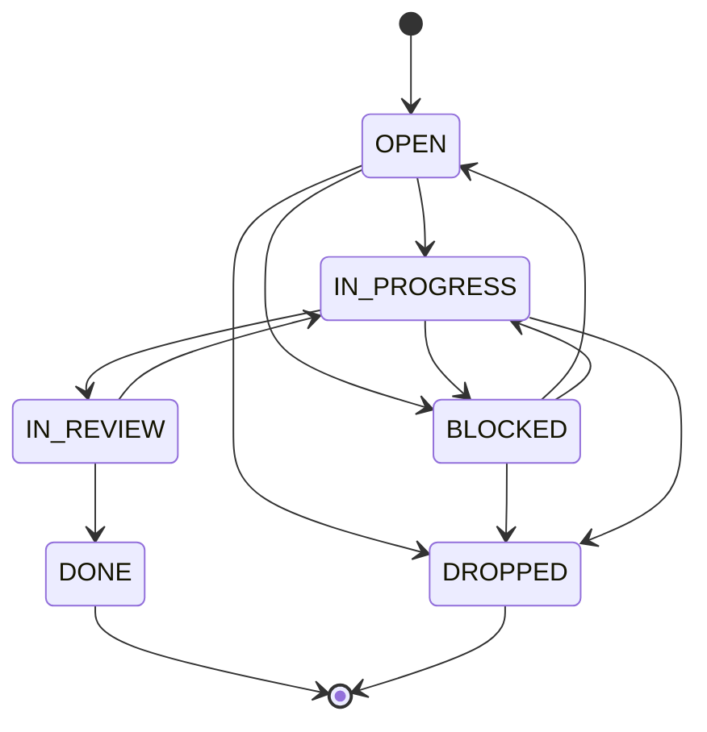

# Agent task lifecycle

Shared lifecycle of all agent task types (system, software, test and support tasks). Each agent
task type description refers to this document and states only its specific rules and deviations.

Agent tasks are created by the orchestrator, usually as derived tasks of a concept or of another
agent task, and are worked on by the role given in `assignee`.

## Statuses

| Status        | Meaning                                                           |
| ------------- | ----------------------------------------------------------------- |
| `OPEN`        | Ready to be started                                               |
| `BLOCKED`     | Cannot be worked on until other tasks are done (see `blocked_by`) |
| `IN_PROGRESS` | The assignee is working on the task                               |
| `IN_REVIEW`   | The work products are waiting for review                          |
| `DONE`        | Review passed; the work products are accepted                     |
| `DROPPED`     | The task was abandoned; the file is kept for history              |

Initial status: `OPEN`. Final statuses: `DONE`, `DROPPED`.

## Transitions

| Transition | Who | Condition |
|------------|-----|-----------|
| `OPEN` → `IN_PROGRESS` | Assignee | Work on the task starts |
| `OPEN` / `IN_PROGRESS` → `BLOCKED` | Assignee or orchestrator | `blocked_by` links the task(s) that must be done first |
| `BLOCKED` → previous status | Assignee or orchestrator | All blocking tasks are `DONE` or `DROPPED` |
| `IN_PROGRESS` → `IN_REVIEW` | Assignee | Work products are complete and listed in `outputs` |
| `IN_REVIEW` → `IN_PROGRESS` | Reviewer | Review findings must be addressed; findings recorded in Log |
| `IN_REVIEW` → `DONE` | Reviewer | Definition of done of the task type is met |
| `OPEN` / `BLOCKED` / `IN_PROGRESS` → `DROPPED` | Chief Engineer | Task is no longer needed; reason recorded in Log |

Every status change updates `updated` and adds an entry to the Log section. Reaching a final
status also sets `closed`.

## Common definition of done

- All items of the task's Scope are covered or explicitly moved to another task.
- All work products are listed in `outputs`.
- Review passed and recorded in Log.
- Type-specific criteria (see the task type description) are met.

## Fields

Common base fields (`type`, `id`, `title`, `status`, `assignee`, `parent`, `created`, `updated`,
`closed`) plus:

| Field | Content |
|-------|---------|
| `parent` | Link to the source task (concept or upstream agent task); may be empty for support tasks |
| `blocked_by` | Links to blocking tasks; mandatory when status is `BLOCKED` |
| `outputs` | Links to the work products created or changed by the task |

Further relation fields between work products (e.g. `implements`, `verifies`) will be defined
together with the rules for work products.

## Working roles (provisional)

| Role | Value of `assignee` |
|------|---------------------|
| System Engineer | `SYSTEM_ENGINEER` |
| Software Architect | `SW_ARCHITECT` |
| Software Developer | `SW_DEVELOPER` |
| Test Engineer | `TEST_ENGINEER` |
| Chief Engineer | `CHIEF_ENGINEER` |
| Reviewer | – (performs the review transitions, never an assignee) |

Final role names are set together with the role profiles.
