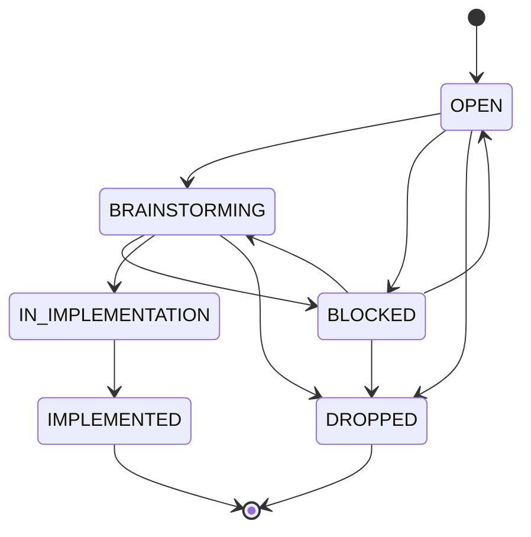

# Concept task

A concept task is the entry point of the process for a given topic. It is created and owned by the
Chief Engineer and works like an epic: it captures, at a high level, what should be achieved.
Once the concept is elaborated, it becomes the input for agent tasks (system requirements,
architecture, implementation, tests).

## Identification

| Item | Rule |
|------|------|
| Type | `type: concept` |
| ID | `CON-NNN` (sequential, never reused) |
| File | `Tasks/Concepts/CON-NNN_short-description.md` |
| Template | [[Process/Templates/Tasks/Concept\|Concept template]] |
| Title | Short, keyword-style description of the topic, e.g. "Determine how weather conditions should be presented" |

## Statuses

| Status | Meaning |
|--------|---------|
| `OPEN` | Ready to be started |
| `BLOCKED` | Cannot be worked on until another concept is elaborated (see `blocked_by`) |
| `BRAINSTORMING` | The Chief Engineer is elaborating the concept, producing notes and ADRs |
| `IN_IMPLEMENTATION` | The concept is closed; agents are working on derived tasks (requirements, architecture, tests, code) |
| `IMPLEMENTED` | All derived tasks are done; the feature is implemented |
| `DROPPED` | The concept was abandoned; the file is kept for history |

## Transitions

| Transition | Who | Condition |
|------------|-----|-----------|
| `OPEN` → `BRAINSTORMING` | Chief Engineer | Work on the topic starts |
| `OPEN` / `BRAINSTORMING` → `BLOCKED` | Chief Engineer | `blocked_by` links the concept(s) that must be elaborated first |
| `BLOCKED` → previous status | Chief Engineer | Blocking concepts have left `BRAINSTORMING` |
| `BRAINSTORMING` → `IN_IMPLEMENTATION` | Chief Engineer only | Chief Engineer declares the concept complete; `outputs` lists all notes and ADRs |
| `IN_IMPLEMENTATION` → `IMPLEMENTED` | Chief Engineer, on orchestrator's request | All derived tasks are done |
| `OPEN` / `BLOCKED` / `BRAINSTORMING` → `DROPPED` | Chief Engineer | Concept is no longer needed; reason recorded in Log |

Every status change updates `updated` and adds an entry to the Log section.

## Outputs

- ADRs: `Architecture/Concept Level/ADR/`
- Notes: `Architecture/Concept Level/Notes/`

Outputs are linked in the `outputs` field. Derived agent tasks point to the concept with
`parent: "[[CON-NNN_...]]"`; the list of derived tasks is therefore visible in backlinks and
is not maintained manually in the concept.
